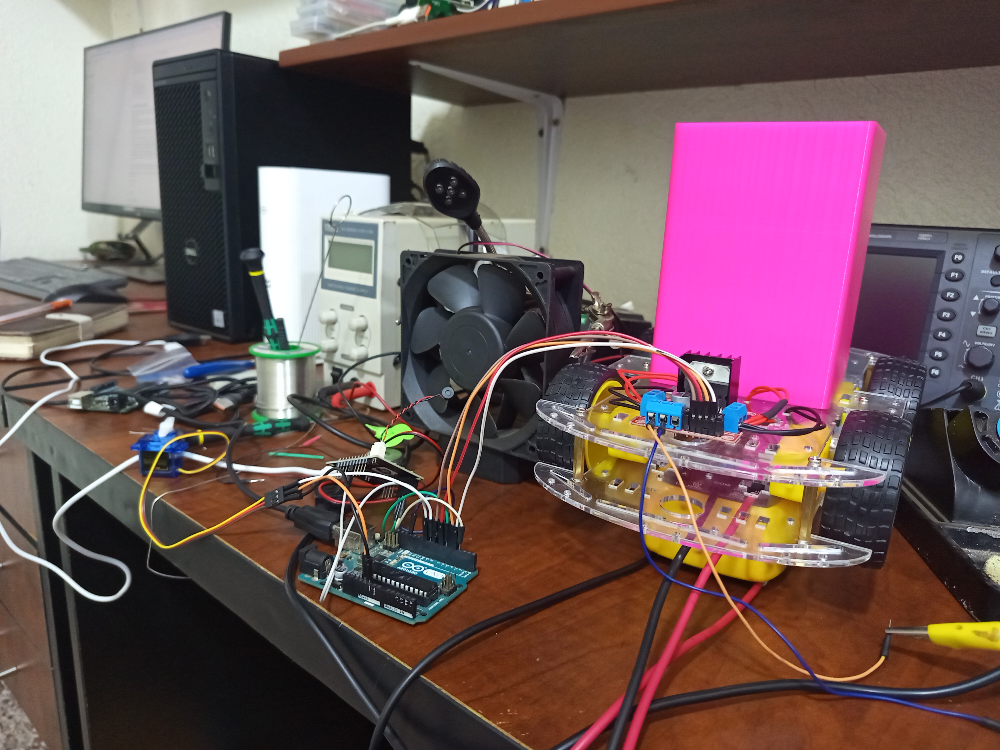

# Smart Voice Controlled Dustbin



An offline, voice-controlled mobile dustbin prototype designed to reduce unnecessary movement and touch during waste disposal. The project explores a surgical-theatre use case: a user speaks a configured command, an AI-Thinker VC-02 module produces a GPIO signal, and an ATmega328P controller moves the platform or opens and closes the lid.

> [!IMPORTANT]
> This is an educational prototype, not a certified medical device. Clinical use would require validated infection-control procedures, safe waste segregation and containment, electrical and mechanical safety assessment, reliable navigation, and approval under applicable hospital and regulatory requirements.

## What the prototype does

- Recognizes configured commands locally on the VC-02; no cloud connection is required during operation.
- Drives a two-channel motor controller for forward and backward movement.
- Stops at an obstacle detected within 20 cm by the active ultrasonic sensor.
- Opens or closes a servo-driven lid from a voice-module level output.
- Shows movement and obstacle status on a 16x2 I2C LCD.

The present firmware provides straight-line forward and backward motion. It does not implement steering, user localization, autonomous routing, or docking.

## Voice commands

The supplied VC-02 configuration images show the following phrases and outputs:

| Behavior | Example phrases | VC-02 output | Controller action |
| --- | --- | --- | --- |
| `collectTrash` | “collect trash”, “come for trash”, “pick trash”, “come pick trash” | `GPIO_B0`, 200 ms pulse | Move forward |
| `takeTrash` | “take trash”, “take trash now”, “take it back”, “take trash back” | `GPIO_B1`, 200 ms pulse | Move backward |
| `openCover` | “open cover”, “open the trash cover”, “open for me”, “please open” | `GPIO_A27`, high level | Open lid to 90 degrees |
| `closeCover` | “close cover”, “close the trash cover”, “close for me”, “please close” | `GPIO_A27`, low level | Close lid to 0 degrees |


## Hardware

The controller sketch and prototype images use:

- ATmega328P controller (Arduino Uno-compatible during development)
- AI-Thinker VC-02 offline voice-recognition module
- Dual-channel H-bridge motor driver and DC gear motors
- Two HC-SR04-style ultrasonic sensors
- 16x2 I2C LCD at address `0x27`
- Hobby servo for the lid
- Mobile chassis, battery supply, wiring, and a common ground
- Optional custom perfboard controller and the supplied 3D-printable enclosure files

The complete wiring table, power notes, bring-up sequence, and test checklist are in the [Hardware Setup Guide](output/pdf/hardware-setup-guide.pdf).

### ATmega328P pin map

| Pin | Connection | Purpose |
| --- | --- | --- |
| D0 / RX | Rear ultrasonic `TRIG` | Trigger while moving backward |
| D1 / TX | Rear ultrasonic `ECHO` | Distance input while moving backward |
| D2 | Front ultrasonic `ECHO` | Distance input while moving forward |
| D3 | VC-02 `GPIO_A27` | Lid open/close level input |
| D5 (PWM) | Motor driver `ENA` | Motor A speed |
| D6 (PWM) | Motor driver `ENB` | Motor B speed |
| D7 | VC-02 `GPIO_B1` | Backward-command pulse |
| D8 | VC-02 `GPIO_B0` | Forward-command pulse |
| D9 | Servo signal | Lid position |
| D10 | Front ultrasonic `TRIG` | Trigger while moving forward |
| D11, D12 | Motor driver `IN1`, `IN2` | Motor A direction |
| D13, A0 | Motor driver `IN3`, `IN4` | Motor B direction |
| A4, A5 | LCD `SDA`, `SCL` | I2C display |

> [!WARNING]
> D0 and D1 are also the ATmega328P hardware serial pins. Disconnect the rear ultrasonic sensor from those pins while uploading if programming becomes unreliable. Do not connect motor power directly to the microcontroller, and join the grounds of the controller, VC-02, sensors, servo supply, and motor driver.

## Software setup

1. Install the Arduino IDE or Arduino CLI.
2. Install the `LiquidCrystal_I2C` library; `Wire` and `Servo` are included with the Arduino AVR core.
3. Open [`robot_controller/robot_controller.ino`](robot_controller/robot_controller.ino).
4. Select the board and programmer that match your ATmega328P setup.
5. Disconnect loads that interfere with programming, especially wiring on D0/D1, then upload.
6. Configure and flash the VC-02 through the [AI-Thinker voice platform](https://voice.ai-thinker.com/) using the outputs shown above.


## Bring-up and testing

1. Test the controller from a current-limited supply with the wheels lifted clear of the bench.
2. Confirm the LCD starts with `Robot stopped / Waiting command`.
3. Trigger the forward and backward inputs separately and verify wheel direction. If a side runs backward, reverse that motor's two output leads.
4. Place an obstacle in front of the active sensor and confirm motion stops at approximately 20 cm; repeat at the rear.
5. With the robot stopped, command the lid open and closed and check for free servo movement.
6. Test voice recognition in progressively noisier environments and keep the platform away from people and equipment until behavior is repeatable.

## Repository layout

```text
.
|-- README.md
|-- LICENSE
|-- robot_controller/
|   `-- robot_controller.ino
|-- images/
|-- output/pdf/
|   `-- hardware-setup-guide.pdf
|-- output.tar.gz
|-- scripts/
|   `-- build_hardware_guide.py
|-- stl files for control circuit casing/
|-- info.txt
`-- report.docx
```

The two STL files form the controller-circuit casing and cover. The photos show the breadboard/prototype stage and the later perfboard build.

`output.tar.gz` contains the supplied VC-02 firmware binaries (`uni_app_debug`, `uni_app_release`, and update variants). Confirm the target module and vendor flashing procedure before using a binary; keep this archive unchanged so its provenance remains clear.


## Known limitations

- No turning or autonomous path planning is implemented.
- A timed-out ultrasonic reading returns `-1`; the firmware then continues driving rather than entering a fail-safe stop.
- The motor speed is fixed at PWM value `80` and may need calibration for the actual load and battery.
- Voice recognition depends on the trained phrases, speaker, microphone placement, and environmental noise.
- The lid can operate only while the motion state is stopped.
- The prototype has not been validated for clinical or hazardous-waste use.

## Further development

Useful next steps include fail-safe sensor handling, independent wheel control for steering, fused and regulated power distribution, obstacle avoidance, localization, a physical emergency stop, washable enclosure surfaces, automatic docking, battery monitoring, and controlled testing against healthcare safety requirements.

## Project media

Watch the [YouTube demonstration video](https://youtu.be/Hfe3AVP62qg?si=XJG9nilrgrlo-J13). Configuration screenshots and build photographs are retained in [`images/`](images/) so the setup can be reproduced and audited.

## License

This project is licensed under the [MIT License](LICENSE). Copyright (c) 2026 Mpuuga Abdu Nasser.
